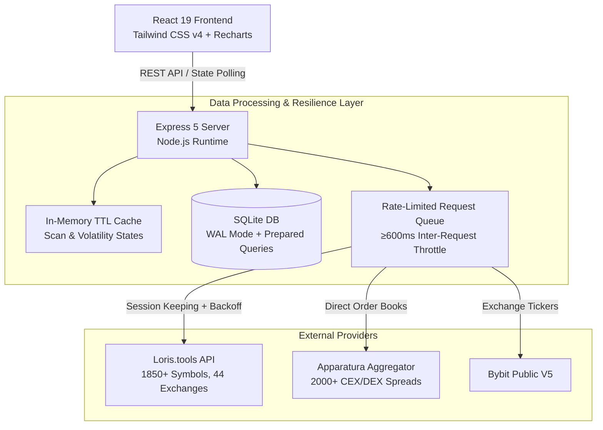

# AGENTS.md — Autonomous Agent Guidelines & Architecture Manual

> **Scope**: This document provides operational guidelines, system architecture, quantitative foundations, and maintenance standards for autonomous AI coding agents interacting with the `funding-arb` repository.

---

## 1. Project Overview & Mission

`funding-arb` is a high-performance quantitative trading scanner and analytics suite designed for delta-neutral cryptocurrency and synthetic forex arbitrage. The platform ingests real-time order books, mark prices, and historical funding rates across **44+ centralized (CEX) and decentralized (DEX) exchanges**, identifying statistical mispricings and execution opportunities across 1,850+ assets.

### Core Modules
1. **Crypto Funding Rate Arbitrage**: 15–30 day persistent cross-exchange funding spreads with outlier trimming and statistical risk penalties.
2. **Short/Long Squeeze Hunter**: Real-time scanner detecting extreme negative funding rates (short squeezes) where short sellers subsidize long holders.
3. **Cross-Exchange Price Spread Arbitrage (Apparatura Engine)**: Order book basis and futures spreads across PERP/PERP and SPOT/PERP with automated risk tiering (Grades A/B/C).
4. **Forex Synthetic Carry Engine**: Yield harvesting across exotic and major currency pairs via decentralized perpetual contracts.

---

## 2. Quantitative & Mathematical Engine

Agents modifying scoring or filtering algorithms must preserve and adhere to these mathematical foundations:

### 2.1 Anti-Spike Metrics (Funding Spreads)
Funding rates frequently experience transient spikes due to temporary liquidations. Raw average APY produces deceptive anomalies. Three filters protect capital:

- **Trimmed Mean APY ($APY_{\text{trimmed}}$)**:
  $$\mu_{\text{trimmed}} = \frac{1}{|S_{\text{valid}}|} \sum_{r \in S_{\text{valid}}} r$$
  Truncates the top and bottom 5% of hourly funding spreads to eliminate single-candle liquidation outliers, modulated by the historical win-rate:
  $$APY_{\text{effective}} = \mu_{\text{trimmed}} \times \left(\frac{\text{Positive Hours}}{\text{Total Hours}}\right)$$

- **Median APY ($APY_{\text{median}}$)**:
  Non-parametric central tendency resistant to arbitrary magnitude deviations ($+1000\%$ spikes do not distort the median). Accompanied by the percentage of profitable 24h rolling windows.

- **Funding Sharpe Ratio ($S_F$)**:
  Penalizes yield instability:
  $$S_F = \frac{\mu_{\Delta \text{funding}}}{\sigma_{\Delta \text{funding}}}$$
  High-yield pairs with extreme variance receive reduced overall composite scores.

### 2.2 Squeeze Severity Classification
Negative funding rates indicate that short positioning is overcrowded:
$$\text{Daily Yield}_{\text{Long}} = |\text{Rate per Period}| \times \left(\frac{24}{\text{Interval Hours}}\right)$$
- **Extreme Squeeze**: $\text{Rate} \le -0.5\%$ per 8h ($\ge 4.5\%$ daily yield).
- **Elevated Squeeze**: $-0.5\% < \text{Rate} \le -0.1\%$ per period.
- **Moderate Squeeze**: $-0.1\% < \text{Rate} < 0\%$.

### 2.3 Spread Arbitrage Risk Grading
Order book spread opportunities are classified into risk profiles based on market depth, daily turnover, open interest, and withdrawal status:
- **Grade A (Institutional / Low Risk)**: Tier-1 venues (Binance, Bybit, OKX, Hyperliquid), 24h Volume $\ge \$250\text{k}$, Open Interest $\ge \$150\text{k}$, Bid/Ask spread drag $< 0.15\%$, net yield after taker fees $> 0.2\%$.
- **Grade B (Moderate Risk)**: Secondary venues (Bitget, Gate, KuCoin, Lighter, Weex), 24h Volume $\ge \$75\text{k}$, net yield $+0.5\%$ to $+10\%$.
- **Grade C (Filtered / High Risk)**: Suspicious basis spreads ($>20\%$, typical of closed wallets/blockchain halts), illiquid books, or untrusted DEX contracts. Automatically quarantined from top recommendations.

---

## 3. High-Resilience System Architecture

Agents must uphold the resilience patterns implemented across both server and client:



### 3.1 Network Throttling & Adaptive Backoff
- **Inter-Request Throttle**: Outbound requests to provider endpoints enforce an asynchronous delay ($\ge 600\text{ms}$) to prevent IP bans.
- **Exponential Backoff**: Upon receiving HTTP 429 (Too Many Requests) or 503 (Service Unavailable), requests retry with exponential jittered delays ($1\text{s} \to 2\text{s} \to 4\text{s} \to \dots$).
- **Session Continuity**: Automatic keep-alive and renewal for session cookies (`loris_session`).

### 3.2 Persistent Caching (SQLite WAL)
- Primary database: `data/funding_arb.db` operated via `better-sqlite3`.
- **Write-Ahead Logging (WAL)**: Enabled by default (`PRAGMA journal_mode = WAL;`) for concurrent non-blocking reads and crash durability.
- **TTL Strategy**: 30-minute historical candle TTL. Repetitive scans or UI filter re-evaluations serve cached SQLite rows without triggering upstream requests.

---

## 4. Repository Structure & Boundaries

```
funding-arb/
├── client/                     # Frontend Application
│   ├── src/
│   │   ├── components/         # Modular UI Components (Tables, Badges, Charts)
│   │   ├── hooks/              # Custom React Hooks (Lifecycle, Polling, State)
│   │   ├── utils/              # Client-side evaluators & URL generators
│   │   ├── App.jsx             # Top-level state and tab router
│   │   └── main.jsx            # React root mount
│   ├── .oxlintrc.json          # Oxlint configuration (Zero warning policy)
│   ├── package.json            # Client dependencies (React 19, Tailwind v4, Vite 8)
│   └── vite.config.js          # Vite build & proxy configuration
├── server/                     # Backend API & Scanners
│   ├── analyzer.js             # Quantitative math (Trimmed mean, Sharpe, Volatility)
│   ├── apparaturaClient.js     # Spread aggregator client & data normalizer
│   ├── borrowChecker.js        # Margin borrow rate verifier
│   ├── bybitClient.js          # Direct exchange ticker client
│   ├── db.js                   # SQLite schema, migrations & prepared statements
│   ├── exchangeMonitor.js      # Loris exchange registry & new venue detection
│   ├── forexConfig.js          # Synthetic forex pairs & margin specs
│   ├── forexDirectClient.js    # Decentralized forex perpetuals scanner
│   ├── index.js                # Express REST API routes & orchestrator
│   ├── spreadAnalyzer.js       # Cross-exchange spread & risk grading engine
│   ├── spreadHistory.js        # Price convergence history & mean reversion calculator
│   ├── squeezeScanner.js       # Short/Long squeeze detection pipeline
│   └── volatility.js           # 24h/7d volatility scoring
├── data/                       # Local SQLite Database (Git-ignored)
├── AGENTS.md                   # This instruction manual
├── package.json                # Root package manager & concurrently scripts
└── README.md                   # Public portfolio & presentation document
```

---

## 5. Development Runbook & Quality Commands

When making modifications, agents **MUST** execute and verify these commands:

### 5.1 Environment Setup
```bash
# Install root dependencies
npm install

# Install client dependencies
npm --prefix client install
```

### 5.2 Linting & Static Analysis (Strict Zero-Warning Policy)
```bash
# Run oxlint on the client workspace (must finish with 0 errors and 0 warnings)
npm --prefix client run lint
```

### 5.3 Build Verification
```bash
# Verify client build succeeds with Vite
npm --prefix client run build
```

### 5.4 Backend Syntax & Import Checks
```bash
# Syntax check all backend modules
node --check server/index.js
```

### 5.5 Local Execution
```bash
# Run both Express API and Vite Dev Server concurrently
npm run dev

# Or run backend only
npm run server
```

---

## 6. Conventions & Agent Rules of Engagement

1. **Strict Lint Discipline**: Never commit code that triggers oxlint warnings. Unused imports, unused arguments, or unhandled exceptions must be cleaned up immediately.
2. **React 19 Concurrency**: Avoid synchronous state updates inside `useEffect` bodies. Use deferred callbacks (`setTimeout`, `queueMicrotask`) or adjust state during render to avoid cascading renders.
3. **Full-Stack ES Modules Architecture**:
   - Both `server/` and `client/` strictly use **ES Modules** (`import` / `export`).
   - Root `package.json` and client `package.json` both define `"type": "module"`.
   - Node.js server relative imports must include the explicit `.js` extension (e.g., `import db from './db.js';`).
4. **Data Isolation**: Runtime caches (e.g., `server/cache/`, `data/*.db`, `data/*.db-wal`) must never be committed to git. Ensure `.gitignore` remains intact.
5. **Preserve Comments & Math Documentation**: Existing quantitative explanations, formulas, and docstrings provide essential domain knowledge and must be preserved during refactoring.
