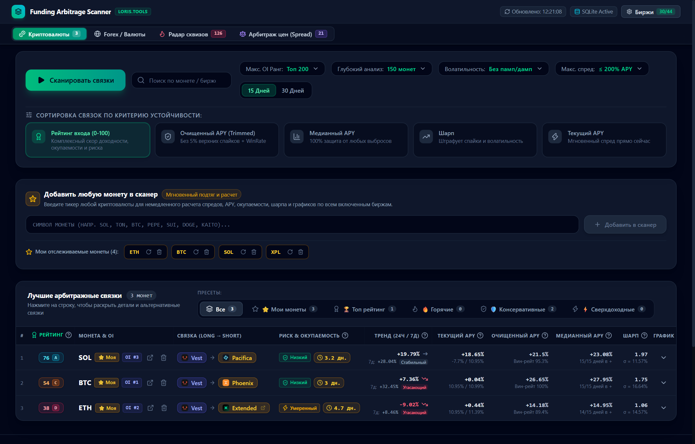
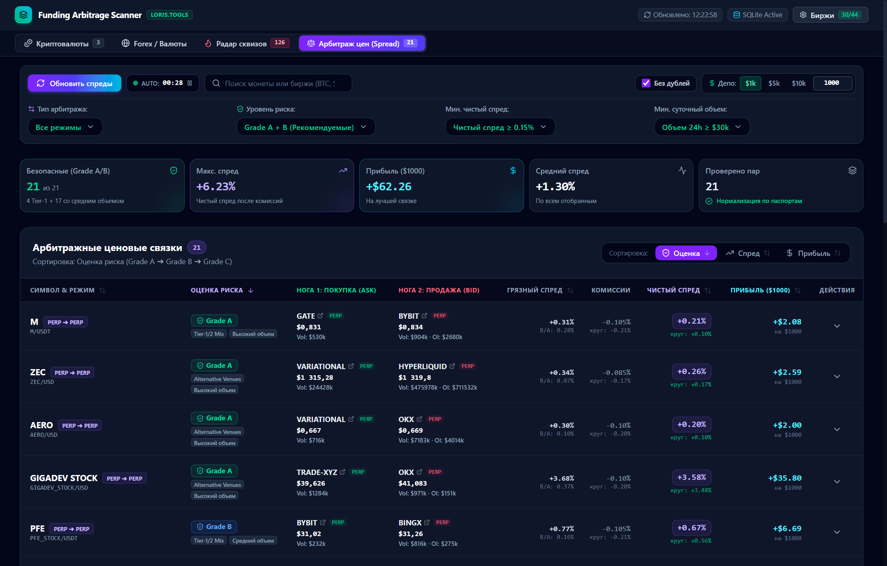
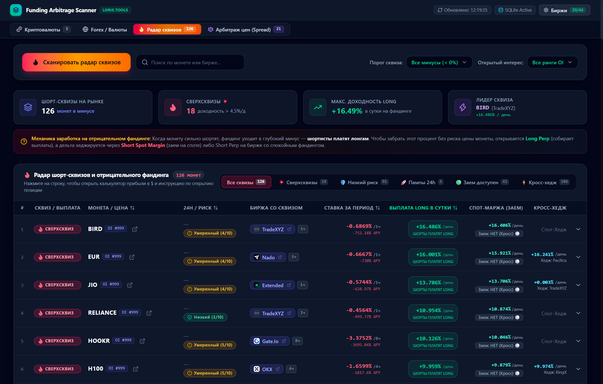
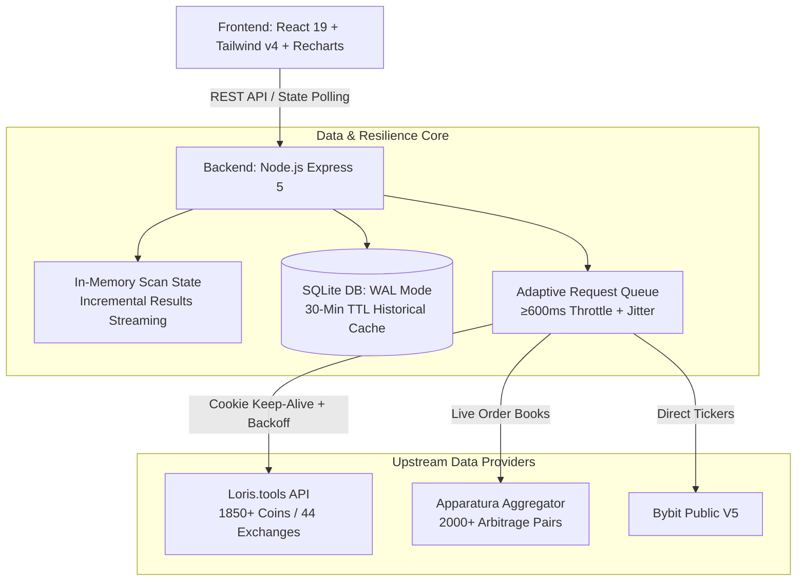

# Delta-Neutral Funding & Spread Arbitrage Suite

[](https://github.com/RylaiCF/funding-arbitrage/actions)
[](https://nodejs.org/)
[](https://expressjs.com/)
[](https://react.dev/)
[](https://sqlite.org/)
[](https://www.docker.com/)
[](https://vitejs.dev/)
[](https://tailwindcss.com/)
[](https://oxc.rs/)
[](LICENSE)

> **Executive Summary (EN)**:  
> An institutional-grade quantitative scanner and delta-neutral trading platform. Ingests and analyzes real-time order books, mark prices, and historical funding rates across **44+ centralized (CEX) and decentralized (DEX) exchanges** and 1,850+ instruments. Features mathematically sound anti-spike metrics (Trimmed Mean, Median, Funding Sharpe Ratio), automated risk tiering (Grades A/B/C), short/long squeeze detection, synthetic forex carry trade tracking, and an industrial-grade resilient backend (adaptive rate-limiting, exponential backoff, and SQLite WAL caching).

---

## 🌟 Ключевые торговые модули

Платформа объединяет 4 независимых алгоритмических сканера:

### 1. Межбиржевой арбитраж фандинга (Crypto Funding Arbitrage)
- Поиск долгосрочных связок со стабильной доходностью на горизонте **15–30 дней**;
- Сбор данных по **1,850+ монетам со всех 44 CEX и DEX бирж** (Binance, Bybit, OKX, Hyperliquid, Bitget, Gate, Paradex, Lighter, Drift, Decibel и др.);
- Устранение манипулятивных спайков через квантильные фильтры (Trimmed Mean, Median, Sharpe).



### 2. Ценовой межбиржевой спред (Spread Arbitrage на базе Apparatura)
- Мониторинг **2,000+ живых связок** стаканов в реальном времени;
- Поддержка двух стратегий:
  - **PERP / PERP**: спред фьючерсов разных площадок;
  - **SPOT / PERP**: классический базисный арбитраж (Cash & Carry);
- Моделирование схождения спреда (Mean-Reversion) на синхронизированной истории 24h–30d;
- Автоматический расчет чистой прибыли с учетом комиссий тейкера обеих бирж (All-In Net Yield).



### 3. Охотник за шорт-сквизами (Squeeze Hunter)
- Детектирование активов с экстремальным отрицательным фандингом (где **шортисты платят держателям лонгов**);
- Ранжирование по суточной доходности: от умеренных до сверхсквизов (≥ 4.5% в день);
- Интегрированный калькулятор доходности и готовые инструкции дельта-нейтрального хеджирования (Long Perp + Short Spot Margin / Short Stable Perp).



### 4. Синтетический Carry-Trade на Forex
- Сканирование децентрализованных бессрочных контрактов на мировые валютные пары (EUR, GBP, JPY, CHF, AUD, CAD, CNH и др.);
- Сравнение дифференциала процентных ставок и ставок фондирования децентрализованных DEX без риска волатильности крипторынка.

---

## 📐 Количественные модели и математический аппарат

В алгоритмах платформы заложен строгий математический аппарат для фильтрации аномалий и защиты капитала:

### 1. Очищенный APY (Trimmed Mean APY)
Исключает случайные спайки и ликвидационные свечи, отсекая верхние и нижние 5% экстремальных значений часовой истории фандинга:
$$\mu_{\text{trimmed}} = \frac{1}{|S_{\text{valid}}|} \sum_{r \in S_{\text{valid}}} r$$
Итоговый эффективный APY модулируется историческим Win-Rate положительных часов:
$$APY_{\text{effective}} = \mu_{\text{trimmed}} \times \left(\frac{\text{Положительные часы}}{\text{Все часы периода}}\right)$$

### 2. Медианный APY
Непараметрическая метрика, математически устойчивая к единичным аномальным всплескам любого масштаба (даже импульс +1000% не искажает медиану). Рассчитывается вместе с процентом прибыльных скользящих суточных окон.

### 3. Коэффициент Шарпа фандинга (Funding Sharpe Ratio)
Оценивает отношение чистой доходности к волатильности (стандартному отклонению) спреда ставок:
$$S_F = \frac{\mu_{\Delta \text{funding}}}{\sigma_{\Delta \text{funding}}}$$
Связки с высокой доходностью, но хаотичными скачками дисперсии получают штрафной балл, защищая трейдера от ложных сигналов.

### 4. Матрица градации рисков (Risk Grades A/B/C)
Каждая связка в реальном времени проходит через воронку риска:
- **Grade A (Институциональный / Низкий риск)**:
  - Биржи Tier-1 (Binance, Bybit, OKX, Hyperliquid);
  - Суточный объем ≥ $250,000, открытый интерес ≥ $150,000;
  - Минимальное проскальзывание стакана (Bid/Ask cost < 0.15%);
  - Чистая доходность за вычетом комиссий обеих бирж > 0.2%.
- **Grade B (Умеренный риск)**:
  - Биржи Tier-2 (Bitget, Gate, KuCoin, Lighter, Weex);
  - Суточный объем ≥ $75,000, доходность от +0.5% до +10%.
- **Grade C / Quarantined (Высокий риск)**:
  - Аномальный спред > 20% (признак заморозки ввода/вывода сети блокчейна или делистинга);
  - Низколиквидные стаканы. Связки автоматически маркируются предупреждением.

---

## 🛡️ Отказоустойчивая архитектура бэкенда

Система спроектирована для надежной круглосуточной работы с внешними API в условиях жестких сетевых лимитов:



### Архитектурные принципы:
1. **Асинхронный троттлинг запросов**: Строгое ограничение исходящего темпа (≥ 600 мс между вызовами) предотвращает блокировку IP-адреса.
2. **Экспоненциальный Backoff с Jitter**: При возникновении HTTP 429 (Rate Limit) или 503 запросы автоматически повторяются с экспоненциально возрастающей паузой (1 с → 2 с → 4 с → ...).
3. **SQLite в режиме WAL (Write-Ahead Logging)**:
   - Включен `PRAGMA journal_mode = WAL;` для одновременного параллельного чтения без блокировки транзакций;
   - TTL кэша исторических рядов — **30 минут**: повторные сканирования или переключение фильтров происходят мгновенно из локальной БД.
4. **Потоковая передача прогресса**: Результаты сканирования отдаются на фронтенд инкрементально по мере обработки монет, исключая таймауты браузера.

---

## 📊 Интерактивный интерфейс

- **Кастомные токены (Custom Coins Bar)**: Возможность мгновенно добавить любой тикер из 1850+ для глубокого анализа истории без полного перезапуска сканера;
- **Интерактивные графики Recharts**: Двойная динамика ставок финансирования (Long Exchange vs. Short Exchange) и чистая кривая спреда;
- **Mean-Reversion схождение**: График истории спреда цен с индикаторами пересечения нуля и оценкой скорости схлопывания;
- **Интерактивный калькулятор**: Мгновенный пересчет PnL в USD под депозиты \$1,000, \$5,000, \$10,000;
- **Управление 44 биржами**: Модальное окно с фильтрами CEX/DEX, быстрым включением/выключением и мониторингом добавления новых площадок.

---

## 📁 Структура репозитория

```
funding-arb/
├── client/                             # React 19 SPA (Vite + Tailwind CSS v4)
│   ├── src/
│   │   ├── components/                 # Модульные компоненты интерфейса
│   │   │   ├── Header.jsx              # Навигация, статус БД и селектор вкладок
│   │   │   ├── ControlsBar.jsx         # Фильтры OI, горизонта и волатильности
│   │   │   ├── CustomCoinsBar.jsx      # Мониторинг индивидуальных монет
│   │   │   ├── OpportunitiesTable.jsx  # Таблица арбитража фандинга
│   │   │   ├── SpreadTable.jsx         # Таблица ценового спреда CEX/DEX
│   │   │   ├── SqueezeTable.jsx        # Таблица шорт-сквизов
│   │   │   ├── ForexStatsBanner.jsx    # Метрики Forex carry trade
│   │   │   ├── ChartTimeline.jsx       # График истории фандинга (Recharts)
│   │   │   ├── SpreadConvergenceChart.jsx # График Mean-Reversion цен
│   │   │   ├── ExchangeModal.jsx       # Модалка управления 44 биржами
│   │   │   └── ...
│   │   ├── hooks/                      # Пользовательские хуки (useScan, useSpreadData, etc.)
│   │   ├── utils/                      # Оценщики рисков, скоринга и генераторы ссылок
│   │   ├── App.jsx                     # Корневой маршрутизатор и оркестратор состояний
│   │   └── main.jsx                    # Входная точка React
│   ├── .oxlintrc.json                  # Конфигурация линтера (0 warnings policy)
│   ├── package.json                    # Зависимости фронтенда
│   └── vite.config.js                  # Конфиг сборки Vite и прокси
├── server/                             # Бэкенд-сервис на Node.js Express 5
│   ├── index.js                        # REST API сервер и раздача статики
│   ├── db.js                           # SQLite (WAL, схемы, кэш, миграции)
│   ├── analyzer.js                     # Количественный анализ (Trimmed, Median, Sharpe)
│   ├── apparaturaClient.js             # Агрегатор ордербуков Apparatura
│   ├── spreadAnalyzer.js               # Анализ ценового спреда и риск-грейды
│   ├── spreadHistory.js                # История схождения спреда
│   ├── squeezeScanner.js               # Сканер шорт- и лонг-сквизов
│   ├── forexConfig.js                  # Спецификации валютных пар
│   ├── forexDirectClient.js            # DEX-клиент для синтетического форекса
│   ├── lorisClient.js                  # Клиент Loris API (сессии, троттлинг, backoff)
│   ├── volatility.js                   # Расчет волатильности и штрафов
│   ├── exchangeMonitor.js              # Мониторинг добавления новых бирж
│   └── borrowChecker.js                # Проверка ставок маржинального займа
├── data/                               # Локальное хранилище SQLite (funding_arb.db)
├── AGENTS.md                           # Руководство для автономных AI-агентов
├── package.json                        # Корневой package.json со скриптами запуска
└── README.md                           # Документация проекта
```

---

## 🚀 Быстрый старт

### 1. Требования
- **Node.js** ≥ 24.0.0
- **npm** ≥ 10.0.0
- *(Опционально)* **Docker** и **Docker Compose**

### 2. Установка
```bash
# Клонирование репозитория
git clone https://github.com/RylaiCF/funding-arbitrage.git
cd funding-arb

# Установка всех зависимостей (бэкенд и фронтенд ставятся одной командой)
npm install
```

### 3. Запуск в режиме разработки
Одной командой поднимаются Express API (порт 3000) и Vite Dev Server (порт 5173 с HMR):
```bash
npm run dev
```
Откройте в браузере: **`http://localhost:5173`**

### 4. Запуск через Docker
Полностью изолированный multi-stage контейнер с сохранением базы SQLite на хосте:
```bash
# Сборка и запуск контейнера
docker compose up --build

# Остановка контейнера
docker compose down
```
Приложение доступно на **`http://localhost:3000`**.

### 5. Проверка качества кода и тесты
```bash
# Запуск количественных тестов и риск-моделей (30 тестов, 0 failures)
npm test

# Статический анализ oxlint (строго 0 ошибок и 0 предупреждений)
npm run lint

# Проверка синтаксиса серверных модулей
node --check server/index.js
```

### 6. Сборка и Production-запуск
```bash
npm run build
npm start
```
Единый сервер обслуживает API и оптимизированный SPA на **`http://localhost:3000`**.
